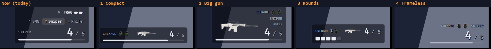
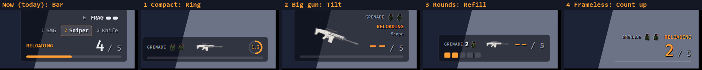

# Loadout menu and HUD prototype

Two web pages with ideas for the game UI. They are not game code.
Pick the ideas you like, then build them into `src/ui.rs`.

- **Loadout page** (`index.html`): ideas for the loadout menu in the pause menu and the lobby.
- **HUD page** (`hud.html`): ideas for the weapon panel at the bottom right of the screen during a match.

Both pages read the same saved loadout. So the HUD shows the guns, sights and grenade picked on the loadout page.

## Run it

You need Python 3 (any recent version) and an internet connection (the pages load three.js from cdn.jsdelivr.net).

- Windows: double-click `run.cmd`. It starts a small local web server and opens the loadout page.
- Any system: from the repo root, run `python -m http.server 8796`, then open
  - `http://127.0.0.1:8796/prototypes/loadout-ui/` (loadout page)
  - `http://127.0.0.1:8796/prototypes/loadout-ui/hud.html` (HUD page)

The server must run from the repo root, because the pages load the real models from `assets/models/`.
Opening the HTML files directly from the disk does not work.

## Loadout page

Today the game uses five buttons that change the gun, sight or grenade one step per click.
You cannot see the choices, and you cannot go back one step.

The bar at the top has four controls:

- **Screen**: the pause menu or the lobby. Both copy the game layout, sizes and colors from `src/ui.rs`.
- **Type**: `Now` is the game today. `1`, `3` and `4` are the ideas.
- **Window**: 1280×720 or 1920×1080. The text on the right says if the panel fits, and the size of the loadout card.
- **Reset loadout**: back to the game default (Rifle, Pistol, Frag, iron sights).

| Type | How it works | Seen in |
|---|---|---|
| 1 Arrows | A 3D view of the gun at the top. Each slot has ‹ › arrows for the gun and small arrows for the sight. Closest to the code of today. | The cycle buttons of today, with images and a way back |
| 3 3D preview | Tabs 1, 2, G. A big 3D gun you can drag to turn. Arrows pick the gun, chips pick the sight. | Phantom Forces weapon preview |
| 4 Cards + popup | A 3D view at the top and three slot cards. A click on a card opens a list of all guns and sights. It closes when you click outside, press Esc, or move the pointer away. | Battlefield-style popup; Hunt: Showdown |

In every idea:

- The 3D view shows the real model with the sight that is on it. Point at a gun or a sight to preview it before you click.
- One click per choice. Picking the gun that is in the other slot swaps the two slots.
- Each gun keeps its own sight, as `Settings::sights` does. The shotgun shows "No sight mount".

## HUD page

The bar at the top has three controls:

- **Type**: the layout of the weapon panel. `Now` is the game today.
- **Reload**: the reload animation. "Type default" uses the style of the chosen type. Any style works with any type, so you can mix and match.
- **Window**: 1280×720 or 1920×1080. The text on the right shows the size of the weapon panel.

Input: hold the left mouse button to fire, `1` `2` `3` switch weapons, `R` reloads, `G` throws a grenade.

The page follows the game rules from `src/weapons.rs` and `src/combat.rs`:

- Fire rate per gun. Rifle and SMG fire while the button is held; Shotgun, Sniper and Pistol fire once per click.
- 0.35 s draw time after a switch (`DRAW_TIME`).
- Reload time per gun. An empty magazine reloads by itself.
- Grenades come back one at a time, at the recharge time of the grenade kind.

| Type | How it works | Seen in |
|---|---|---|
| 1 Compact | One row: grenade icons, gun image, ammo. | Counter-Strike 2 weapon list |
| 2 Big gun | A large gun image; name, sight name and ammo beside it. | Halo Infinite, larger weapon info |
| 3 Rounds | One mark per round. A gap every 10 rounds; wide shell marks for 6 rounds or fewer. Grenade count next to its icon. | Classic Halo ammo counter; Halo 3 grenades |
| 4 Frameless | No box: name, big ammo, thin bar and icons, with a strong text outline. | Overwatch 2 minimalist HUD |

In types 1 to 4:

- Only the gun in your hand shows. On a switch, a strip with the three slots shows for about 1.5 s, then fades out.
- Grenades show as the word GRENADE and one icon per grenade. A thrown grenade goes grey and fills from the bottom while it recharges, and pulses when ready.
- A full magazine is a little dim. Low ammo (a quarter or less, the same rule as `src/ui.rs`) turns orange.
- After 3 s without an action, the panel fades. It never fades during a reload or with low ammo.
- Each shot gives the ammo number a short kick. The gun image slides in on a switch.

### Reload styles

| Reload style | What happens | Default for |
|---|---|---|
| Bar | The ammo bar fills (the game today). | Now |
| Ring | A ring fills around the seconds left. | 1 Compact |
| Tilt | The gun image tips down and comes back up; the ammo shows `--`. | 2 Big gun |
| Refill | Round marks fill one by one. | 3 Rounds |
| Count up | The ammo number counts up from 0 to the magazine size. | 4 Frameless |

## Files

| File | What it does |
|---|---|
| `index.html` | Loadout page: the top bar, the pause screen and the lobby screen. |
| `hud.html` | HUD page: the top bar and the match screen with the weapon panel. |
| `shell.css` | Game colors (the constants at the top of `src/ui.rs`), the top bar and the screen layout. |
| `shell.js` | Loadout page: the top bar, and the scaling of the 1280×720 stage. |
| `hud-shell.js` | HUD page: the top bar, mouse and keys, and the scaling of the stage. |
| `data.js` | Guns (with fire rate), sights, grenades, knife and binds, copied from `src/weapons.rs` and `src/protocol.rs`. |
| `loadout.js` | The loadout rules (swap, sight per gun, next and previous), the saved state, and `mountType`: drawing, clicks, Esc and the 3D view. |
| `types.js` | The loadout types (`now`, `arrows`, `preview`, `cards`). |
| `loadout.css` | Styles of the loadout types. |
| `hud.js` | The HUD: fire, reload, draw time, grenades, the four types and the five reload styles. |
| `hud.css` | Styles of the HUD types and the reload styles. |
| `viewer.js` | three.js: loads the models, puts the sight on the gun, makes the small images and the 3D view. |

## How the 3D view matches the game

`viewer.js` does the same steps as `src/gun_model.rs`:

1. Turn the model so the barrel points the same way for every gun (`barrel_plus_z`).
2. Measure the gun without a sight, centre it and scale it.
3. Add the sight model as a child of the `SightMount` node, and hide the nodes whose names start with `IronSight`.

## Notes to build it in Bevy

- Loadout types 1 and 4, and all HUD types, need only nodes, text, borders and images. Bevy UI has all of these.
- The 3D view: a second `Camera3d` that renders to an `Image` (render to texture), shown with `ImageNode`. Put the gun on its own render layer so the game scene does not show in it.
- The small gun images: render each gun and sight once at startup with the same camera, or ship PNG icons.
- The popup in loadout type 4: `PositionType::Absolute` with a `GlobalZIndex`.
- Esc: close the popup first, and only then resume the game.
- HUD reload styles: Bar uses the existing `Bar::Ammo`. Ring needs a round progress shape (an image with a material, or a ring texture with a fill). Tilt is a rotation of the gun image node. Refill and Count up are nodes and text updated each frame.
- HUD idle fade and the switch strip: change the node `BackgroundColor` and text alpha over time.
