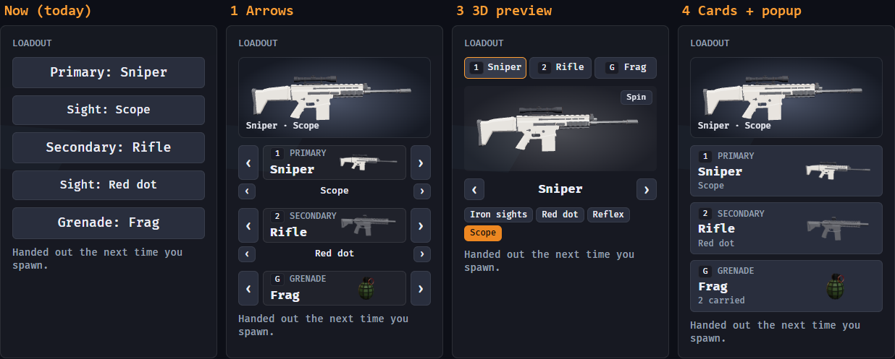

# Loadout menu prototype

A web page that shows ideas for a new loadout menu. It is not game code.
Pick one idea, then build that idea into `src/ui.rs`.

The game shows the loadout in two places: the pause menu and the lobby.
Today it uses five buttons that change the gun, sight or grenade one step per click.
You cannot see the choices, and you cannot go back one step.

## Run it

You need Python 3 (any recent version) and an internet connection (the page loads three.js from cdn.jsdelivr.net).

- Windows: double-click `run.cmd`. It starts a small local web server and opens the page.
- Any system: from the repo root, run `python -m http.server 8796`, then open
  `http://127.0.0.1:8796/prototypes/loadout-ui/`.

The server must run from the repo root, because the page loads the real models from `assets/models/`.
Opening `index.html` directly from the file does not work.

## Use it

The bar at the top has four controls:

- **Screen**: the pause menu or the lobby. Both copy the game layout, sizes and colors from `src/ui.rs`.
- **Type**: `Now` is the game today. `1`, `3` and `4` are the ideas.
- **Window**: 1280×720 or 1920×1080. The text on the right says if the panel fits, and the size of the loadout card.
- **Reset loadout**: back to the game default (Rifle, Pistol, Frag, iron sights).

## The ideas

| Type | How it works | Seen in |
|---|---|---|
| 1 Arrows | A 3D view of the gun at the top. Each slot has ‹ › arrows for the gun and small arrows for the sight. Closest to the code of today. | The cycle buttons of today, with images and a way back |
| 3 3D preview | Tabs 1, 2, G. A big 3D gun you can drag to turn. Arrows pick the gun, chips pick the sight. | Phantom Forces weapon preview |
| 4 Cards + popup | A 3D view at the top and three slot cards. A click on a card opens a list of all guns and sights. It closes when you click outside, press Esc, or move the pointer away. | Battlefield-style popup; Hunt: Showdown |

In every idea:

- The 3D view shows the real model with the sight that is on it. Point at a gun or a sight to preview it before you click.
- One click per choice. Picking the gun that is in the other slot swaps the two slots.
- Each gun keeps its own sight, as `Settings::sights` does. The shotgun shows "No sight mount".

## Files

| File | What it does |
|---|---|
| `index.html` | The top bar, the pause screen and the lobby screen. |
| `shell.css` | Game colors (the constants at the top of `src/ui.rs`) and the screen layout. |
| `shell.js` | The top bar, and the scaling of the 1280×720 stage. |
| `data.js` | Guns, sights, grenades and binds, copied from `src/weapons.rs` and `src/protocol.rs`. |
| `loadout.js` | The rules (swap, sight per gun, next and previous), the saved state, and `mountType`: drawing, clicks, Esc and the 3D view. |
| `types.js` | The four types (`now`, `arrows`, `preview`, `cards`). |
| `loadout.css` | Styles of the four types. |
| `viewer.js` | three.js: loads the models, puts the sight on the gun, makes the small images and the 3D view. |

## How the 3D view matches the game

`viewer.js` does the same steps as `src/gun_model.rs`:

1. Turn the model so the barrel points the same way for every gun (`barrel_plus_z`).
2. Measure the gun without a sight, centre it and scale it.
3. Add the sight model as a child of the `SightMount` node, and hide the nodes whose names start with `IronSight`.

## Notes to build it in Bevy

- Types 1 and 4 need only nodes, text, borders and images. Bevy UI has all of these.
- The 3D view: a second `Camera3d` that renders to an `Image` (render to texture), shown with `ImageNode`. Put the gun on its own render layer so the game scene does not show in it.
- The small gun images: render each gun and sight once at startup with the same camera, or ship PNG icons.
- The popup in type 4: `PositionType::Absolute` with a `GlobalZIndex`.
- Esc: close the popup first, and only then resume the game.
