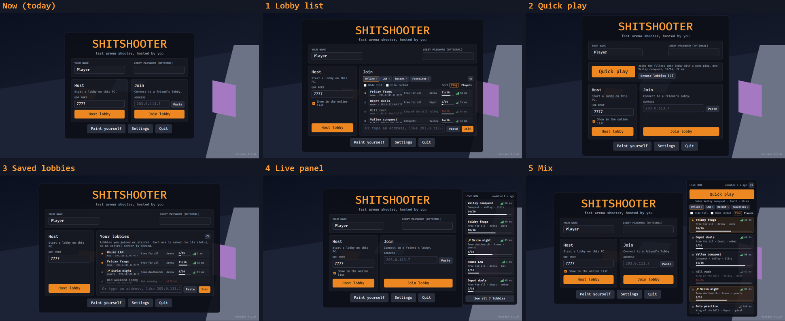
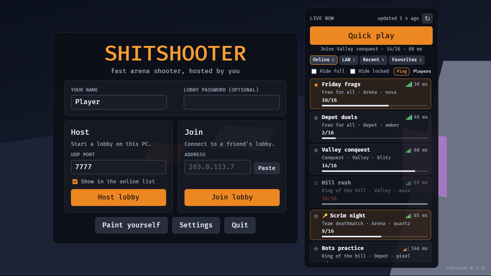
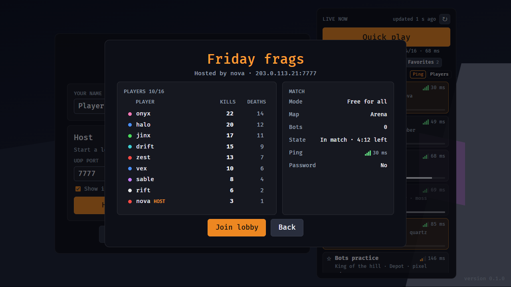
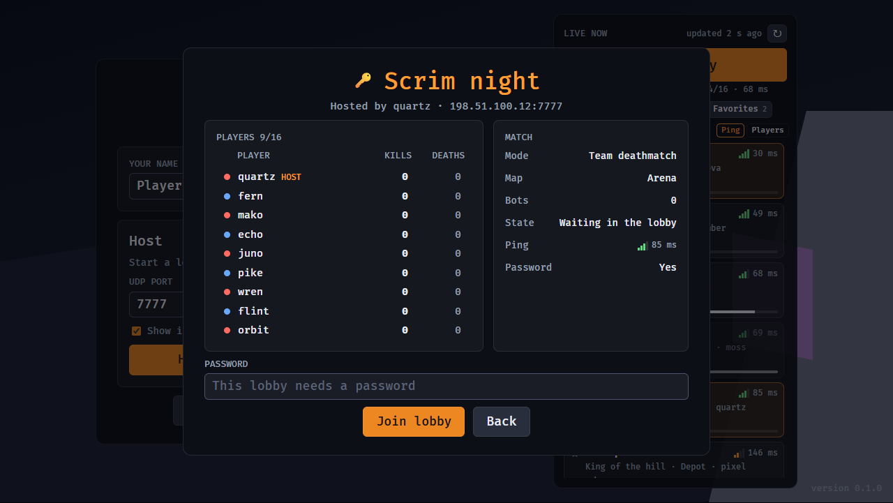

# Lobby ideas for the main menu

A web page with ideas to reach running lobbies from the main menu. It is not game code.
Pick the idea you like, then build it into `src/ui.rs` and `src/net.rs`.

Today the main menu (`spawn_menu` in `src/ui.rs`) has two ways in: host a lobby, or join one by typing its address.
You cannot see which lobbies are running.

## Run it

Double-click `index.html`. It opens in your browser. No server and no install are needed.
(Internet is optional: it only loads the Fira Mono font from Google Fonts.)

## Use it

The bar at the top has two controls:

- **Type**: `Now` is the game today. `1` to `5` are the ideas. The page opens on `5`.
- **Window**: 1280×720 or 1920×1080. The text on the right says if the menu fits.

All lobby data is made up. The addresses use documentation ranges (203.0.113.x and 198.51.100.x) and 192.168.1.x for LAN.

## The ideas

| Type | How it works | Seen in |
|---|---|---|
| 1 Lobby list | The Join card becomes a list with tabs Online, LAN, Recent and Favorites; filters (hide full, hide locked); sort by ping or players; a key icon for a password. The address field stays at the bottom. Host gets "Show in the online list". | Counter-Strike server browser; Valheim |
| 2 Quick play | A big button joins the fullest open lobby with a good ping. "Browse lobbies" opens the list over the menu. | Krunker Quick Match |
| 3 Saved lobbies | Your recent and starred addresses, each with live status, ping and players, or "Not running". No central server needed. | Minecraft server list |
| 4 Live panel | The menu stays as today; a side panel shows the busiest open lobbies, refreshed every 5 s. | Live lists in many games |
| 5 Mix | The menu stays as today, plus "Show in the online list". Next to it, a live lobby browser: Quick play, tabs, filters, sort, stars and live cards. A lobby whose player count changed glows for 2 s. | Types 1, 2 and 4 together |

## Lobby info screen

A click on a lobby (in any type) opens an info screen before you join, built like the game's own LOBBY screen:

- **Players**: the roster with kills and deaths (sorted by kills during a match), the host tag, and the bots.
- **Match**: mode, map, bots, state ("In match · 4:12 left" or "Waiting in the lobby"), ping and password.
- **Join lobby** and **Back**. A locked lobby has its password field here. A full lobby shows a disabled "Full" button.
- **Back** or Esc returns to where the click came from. Quick play joins at once, without this screen.

## What the game needs

From the simplest to the hardest. Each idea uses some of these:

1. **Recent and Favorites**: save the joined addresses in the settings file. No network work.
2. **Status of a known address** (types 3 and 5, and the info screen): a small info query to the host. The host answers with its name, mode, map, players, bots, state, time left, the password flag, and the roster (names and scores). This works like Minecraft's Server List Ping. It needs its own UDP port next to the game port (for example port + 1), because the renet netcode socket only accepts its own packets.
3. **LAN**: send the same info query as a UDP broadcast on the local network. Every host answers.
4. **Online list**: a small public list server. Hosts send a heartbeat every 30 s, and players ask for the list. Every host's public IP is visible to everyone who opens the list, so "Show in the online list" must be the host's choice. Hosts still need to forward the UDP port.

A password lobby can show in every list with a key icon. The password stays inside the netcode protocol id (`protocol_id` in `src/protocol.rs`), so a list never needs it.

## Files

| File | What it does |
|---|---|
| `index.html` | The top bar and the main menu screen. |
| `shell.css` | Game colors (the constants at the top of `src/ui.rs`), the top bar, panels, cards, roster rows. |
| `lobbies.css` | Styles of the main menu, the lobby lists, the live panel and the info screen. |
| `lobbies.js` | The made-up lobbies, the five types, the info screen, the clicks. |
| `lobbies-shell.js` | The top bar, the scaling of the 1280×720 stage, Esc, and the live refresh. |

## Notes to build it in Bevy

- All types need only nodes, text, borders and buttons. Bevy UI has all of these.
- The lists need a scrolling node (`Overflow::scroll_y()`) with a thin, see-through scrollbar.
- The info screen: a panel with `PositionType::Absolute` and a `GlobalZIndex`, like the settings screen.
- The live refresh: run the info query on a timer (every 5 s) and update the cards in place.
